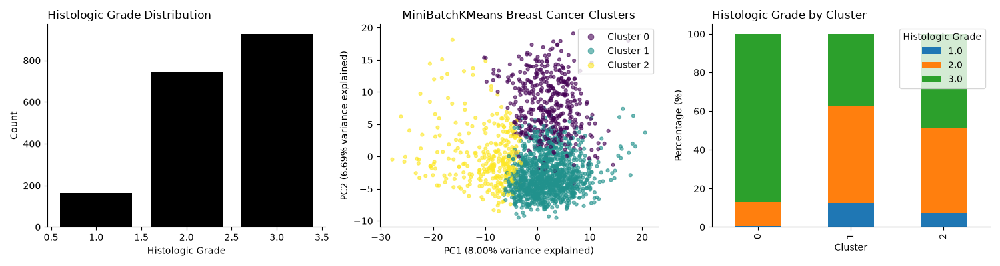

# METABRIC Breast Cancer Data Analysis

This project uses Python scientific software libraries to analyze the METABRIC breast cancer dataset. The analysis investigates the relationship between gene-expression measurements and histologic tumor grade using unsupervised machine learning.

## Histologic Grade Clustering Analysis

### Introduction

The objective of this analysis is to investigate whether breast cancer tumors with similar gene-expression profiles also share similar histologic grades. 

Histologic grade describes the microscopic appearance of tumor cells and is used to estimate the tumor cells likely growth behavior.  Breast cancer is categorized as Grade 1 (low), Grade 2 (intermediate), or Grade 3 (high).

Gene-expression data for 331 genes are represented using mRNA z-scores. The z-score indicates how many standard deviations a gene's expression in a particular tumor is above or below the mean expression of that gene in the reference population.

We use MiniBatchKMeans, an unsupervised machine-learning algorithm, to group tumor samples based on normalized gene-expression measurements. Our hypothesis is that tumors with similar gene-expression patterns may also have similar histologic grades.

### Results

The METABRIC dataset contains 1,904 tumor samples, of which 1,832 have known histologic grades. Among samples with known grades, 165 are Grade 1, 740 are Grade 2, and 927 are Grade 3. 

MiniBatchKMeans was used to divide the samples into three clusters based on their gene-expression measurements.

To visualize the clusters, Principal Component Analysis (PCA) was used to reduce the 331 gene-expression measurements to two principal components. The first two principal components explained 14.69% of the total variation in gene expression. The model produced a silhouette score of 0.067, indicating weak separation between clusters in the original 331-dimensional gene-expression space.

| Cluster | Total Samples | Grade 1 (%) | Grade 2 (%) | Grade 3 (%) |
|---|---:|---:|---:|---:|
| 0 | 429 | 0.48 | 12.35 | 87.17 |
| 1 | 1,149 | 12.67 | 50.14 | 37.19 |
| 2 | 326 | 7.52 | 43.79 | 48.69 |

Grade percentages are calculated using only tumor samples with known histologic grades within each cluster, while cluster sizes include all 1,904 tumor samples. Histologic grades were not used to fit the clustering model. Samples with missing grades were included in clustering but excluded from the grade comparison. 

Cluster 0 contained a substantially higher proportion of Grade 3 tumors (87.17%) compared with the other clusters. Clusters 1 and 2 showed more mixed distributions of histologic grades.

These results suggest that gene-expression patterns may be associated with histologic grade, particularly among samples assigned to Cluster 0. However, the three clusters did not correspond directly to the three histologic grades.



### Methods

The analysis was performed in Python using pandas, Matplotlib, and scikit-learn.

1. Loaded the METABRIC dataset using pandas.
2. Extracted normalized gene-expression measurements, excluding clinical metadata and mutation columns.
3. Applied MiniBatchKMeans with three clusters (`n_clusters=3`) and a random seed of 0.
4. Assigned each tumor sample to a cluster based on gene-expression similarity.
5. Applied Principal Component Analysis (PCA) to reduce the 331 gene-expression features to two dimensions for visualization.
6. Calculated the silhouette score using the original 331 gene-expression features to evaluate cluster separation
7. Compared cluster assignments with known histologic grades using pandas.
8. Generated three plots showing histologic grade distribution, molecular clusters in PCA space, and histologic grade percentages within each cluster.

The gene-expression measurements were already normalized as z-scores, so no additional feature scaling was applied. Three clusters were selected to explore their correspondence with the three histologic grades, rather than through an optimization procedure.

## Installation and Reproduction

### Environment Setup

The project uses a Mamba-managed environment defined in `environment.yml`.

From the repository root, create and activate the environment:

```bash
mamba env create -f environment.yml
mamba activate METABRIC
```

### Download Dataset

The dataset used in this project is [Breast Cancer Gene Expression Profiles (METABRIC)](https://www.kaggle.com/datasets/raghadalharbi/breast-cancer-gene-expression-profiles-metabric), available on Kaggle.

Download the `METABRIC_RNA_Mutation.csv` file and place it in the `data/` directory at the repository root.

If the directory does not already exist, create it using:

```bash
mkdir -p data
```

The expected file location is:

```text
data/METABRIC_RNA_Mutation.csv
```

The dataset is downloaded separately and is not included in the GitHub repository.

### Run Analysis

From the repository root, execute:

```bash
python src/histologic_grade_clustering.py
```

The script prints the histologic grade distribution, cluster composition, and cluster sizes.

It also generates and saves the visualization to:

```text
figures/histologic_grade_clustering.png
```